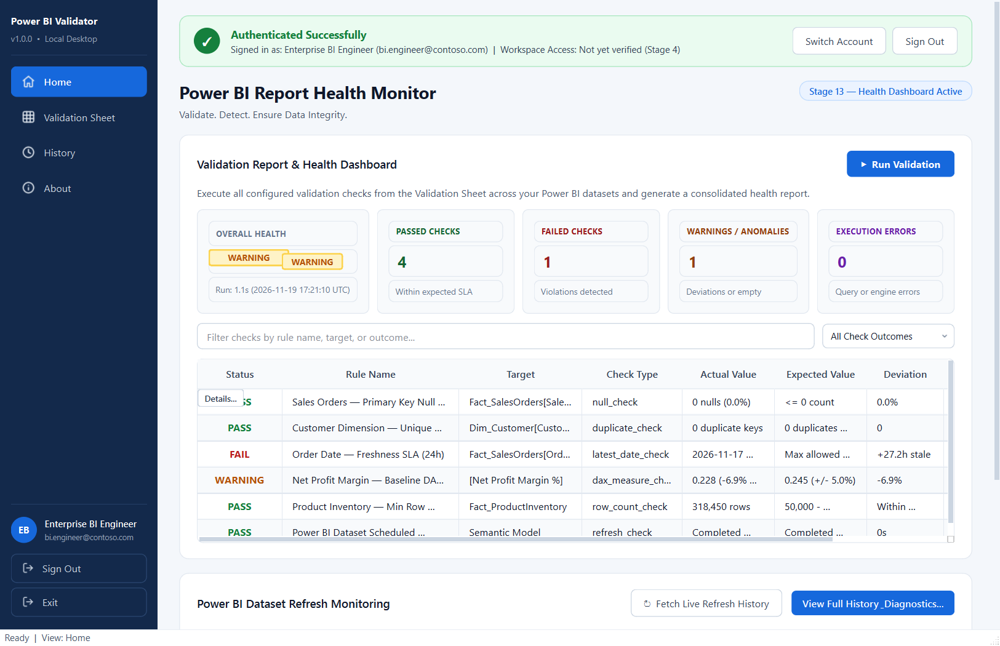
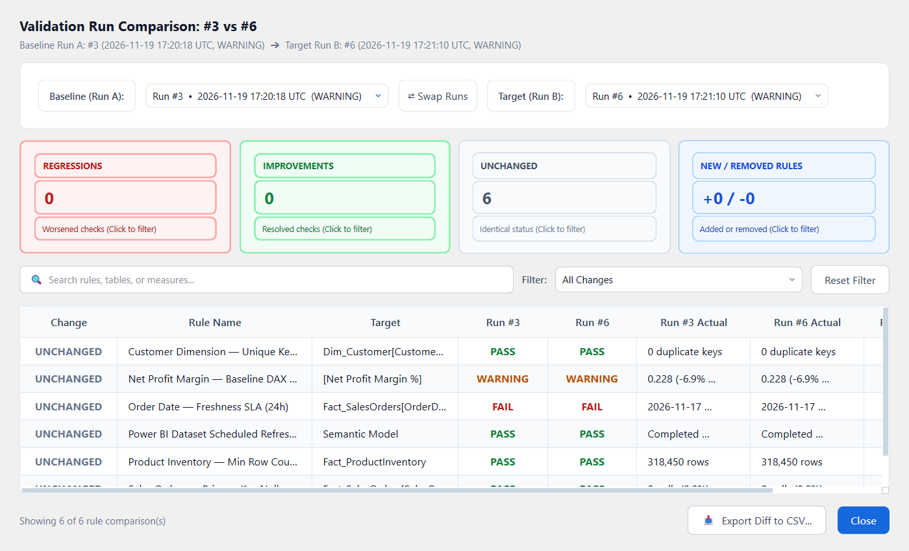
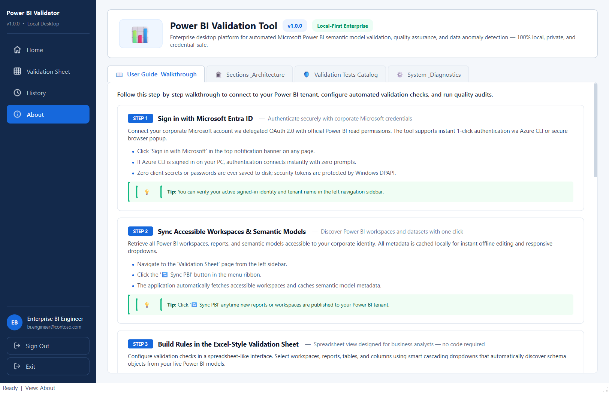

# Power BI Validation Tool

A local-first Windows desktop application for automating Power BI semantic model, refresh, DAX measure, and data quality validation.

[](https://www.python.org/)
[-41CD52.svg)](https://www.qt.io/)
[](https://www.sqlalchemy.org/)
[](docs/RELEASE_NOTES_v1.0.0.md)
[](tests/)

---

## ⚡ The Problem: Why This Tool Is Essential

Managing enterprise Power BI environments often forces BI teams and data engineers to manually inspect dozens or hundreds of reports every single morning:

* **2 to 3 Hours Wasted Daily**: Teams spend hours clicking through workspaces just to verify whether overnight dataset refreshes completed on schedule or failed silently.
* **False-Positive "Successful" Refreshes**: A Power BI dataset refresh might complete successfully with a green checkmark, even when underlying source tables loaded zero rows, missing primary keys, or thousands of duplicate records.
* **Undetected Metric & KPI Drift**: Subtle upstream schema changes or ETL logic shifts can distort critical DAX measures (like gross margin or revenue) without triggering any pipeline error.
* **No Historical Diff or Regression Tracking**: When leadership asks *"Why does this metric differ from yesterday?"*, teams rarely have an audit history to compare validation runs side by side and pinpoint exactly which rule worsened.

### 💡 The Solution: Automated 60-Second Quality Assurance
The **Power BI Validation Tool** automates your entire morning audit routine into a single one-click workflow:
1. **Power BI Refresh SLA Monitoring**: Automatically captures refresh statuses, run durations, and completion ages across all models.
2. **Comprehensive Data Quality Checks**: Enforces row count floors/ceilings, null thresholds, duplicate primary key constraints, and transaction freshness dates.
3. **Live DAX Measure & Baseline Testing**: Directly evaluates complex measures against fixed tolerances or statistical baselines with multi-column filter contexts.
4. **Side-by-Side Run Comparison**: Instantly diff any two validation runs to spot regressions (worsened checks), resolved checks, and schema additions.
5. **Zero-Trust, Local-First Security**: Runs entirely on your local Windows PC using your corporate Microsoft Entra ID. No proprietary data or tokens are ever sent to third-party clouds.

---

## 🎬 Software Tour & Video Walkthrough

[](https://www.youtube.com/watch?v=JnB3j8Ujp7k)


---

## 📸 Application Tour & Interface Showcase

Explore the application screens and core capabilities below:

### 1. 📊 Executive Dashboard & Live Model Health Monitor
> **Real-time validation dashboard with Microsoft Entra ID authentication, multi-metric KPI summary cards, rule-level execution table, and background dataset refresh tracking.**



* **Enterprise Entra ID Sign-In**: Zero-trust authentication with tenant selection, account switching, and DPAPI session protection.
* **Model Health Overview**: Instant KPI metrics displaying overall status (`PASS`, `WARNING`, `FAIL`, `ERROR`), passed count, anomalies, and runtime duration.
* **Detailed Execution Table**: Interactive results grid with colorful bold status badges, expected vs. actual values, percentage deviations, and single-click diagnostic details.
* **Power BI Refresh Monitoring**: Background tracking of scheduled refresh history, distinguishing latest attempts from successful completions with duration and reliability rates.

---

### 2. 📝 Validation Sheet - Spreadsheet-Style Test Designer
> **Configure, parameterize, and manage all your validation tests in an intuitive Excel-style spreadsheet interface.**


* **Familiar Spreadsheet Grid**: Add rows, toggle test enablement, and select workspaces, semantic models, and check types directly from dropdowns.
* **Supported Validation Check Types**:
  * 🔍 **Null / Blank Check**: Detects missing or empty primary/foreign keys with count and percentage thresholds.
  * 🔁 **Duplicate Check**: Enforces uniqueness across single or composite primary key columns.
  * 📅 **Latest Date Freshness**: Verifies transaction freshness SLAs (e.g. 24h) and detects future date anomalies.
  * 🧮 **DAX Measure Check**: Evaluates measures directly against Power BI semantic models with baseline deviations.
  * 📈 **Row Count Check**: Validates table scale against fixed bounds or previous execution baselines.
  * ⏱️ **Refresh SLA Check**: Asserts Power BI service dataset refresh completion within expected SLA windows.
* **Ribbon Actions**: One-click actions to `Add Row`, `Delete Row`, `Save Sheet`, `Export Sheet` to CSV/XLSX, `Import Tests`, and `Sync PBI` catalog.

---

### 3. 📜 Historical Audit Trail & Run Explorer
> **Comprehensive historical run archive with Excel-style multi-column filtering, universal search, and per-check diagnostic drawer.**


* **Execution Runs Log**: Complete chronology of every validation execution with ID, timestamp, duration, overall status, and check pass/fail ratios.
* **Excel-Style Filters**: Universal text search, status dropdown filters (`Failed Only`, `Passed Only`), and date range pickers.
* **Result Drawer**: Select any run to instantly inspect all individual rule outcomes in the lower drawer without leaving the page.
* **Export Actions**: Export runs to styled Excel workbooks (`.xlsx`), raw CSV, or sanitized diagnostic text reports.

---

### 4. ⚖️ Side-by-Side Run Comparison & Regression Diff
> **Pinpoint regressions, resolved checks, and rule additions between any two validation execution runs.**



* **Interactive Run Selectors**: Live dropdowns for **Baseline Run (A)** and **Target Run (B)** with a `⇄ Swap Runs` button for instant re-comparison.
* **Diff Classification Cards**: Filterable KPI cards for **WORSENED** (regressions), **RESOLVED** (improvements), **UNCHANGED**, and **NEW / REMOVED RULES** with descriptive info tooltips.
* **Filterable Diff Table**: Universal text search by rule name or target, change type filter, and generous interactive column widths.
* **Diff Export**: One-click **`📥 Export Diff to CSV`** button for team reviews and audit documentation.

---

### 5. 🗄️ Database Health & Storage Maintenance
> **Full visibility into local SQLite database metrics with compaction, live backups, integrity checks, and retention pruning.**


* **Storage Health Overview**: Live database path, file size in KB/MB, total stored runs, results, rules, and active date range.
* **Compaction (VACUUM)**: Reclaim unused storage and defragment database pages on demand.
* **Transaction-Safe Backups**: Online SQLite snapshot creation without stopping active validations or the user interface.
* **Windows-Safe Restoration**: Safely replaces and validates database files while managing connection pools and WAL logs.
* **Interactive Retention Pruning**: Live preview of eligible runs older than $N$ days before permanent deletion.

---

### 6. 📘 Integrated Architecture & User Manual (About Page)
> **Comprehensive application guide, architectural specifications, and real-time environment diagnostics.**



* **Architecture & Zero-Trust Cloud Specs**: Details on local-only query evaluation, DPAPI secret encryption, and security policies.
* **Step-by-Step User Manual**: Interactive guides for setting up Azure Entra ID, creating validation sheets, inspecting DAX queries, and automating tests.
* **Live System Diagnostics**: Real-time validation of SQLite connection, DPAPI protection, log paths, and Power BI REST connectivity.

---

---

## 🌟 Overview & Key Features

The **Power BI Validation Tool** provides a local-first, zero-trust data quality monitoring engine designed specifically for Power BI semantic models and reports. All query evaluations, statistical calculations, and historical records remain on your local desktop.

### 🛡️ Security & Privacy First
- **No Third-Party Cloud Transmission**: Queries are executed directly against Power BI endpoints via official Microsoft REST APIs; raw data never leaves your local machine.
- **Enterprise Microsoft Entra ID Authentication**: MSAL OAuth 2.0 PKCE sign-in with multi-tenant support (`organizations` or custom tenant ID).
- **Windows DPAPI Encryption**: Tokens are protected with Windows `CryptProtectData` tied directly to your active Windows logon session.
- **Automated Secret Redaction**: Access tokens, bearer auth headers, and client secrets are scrubbed from logs, UI banners, clipboard, and exported files.
- **Azure CLI Fallback**: One-click authentication fallback for developers with active `az login` sessions.

---

## 📋 Comprehensive Capabilities

### 1. Workspace & Dataset Registry (Stages 4, 5 & 6)
- Tabular registry with active/inactive toggles and deletion protection.
- Auto-fill dropdowns populated directly from live Power BI APIs.
- Quick Add dialog for batch workspace/dataset registration.
- Bulk import of datasets via CSV and Excel (`.xlsx`) with row-level validation and error reporting.
- Semantic model metadata discovery (DMVs: `$SYSTEM.TMSCHEMA_TABLES`, `COLUMNS`, `MEASURES` + REST fallback).

### 2. Validation Rule Engine (Stages 7, 10 & 11)
- **Null / Blank Check**: Detects missing or empty strings against count and percentage limits.
- **Duplicate Check**: Validates uniqueness on single or composite primary key columns.
- **Latest Date Freshness Check**: Enforces freshness SLAs (hours/days) and detects future date violations.
- **Row Count Check**: Compares dataset size against fixed baselines, min/max ranges, or previous run row counts.
- **Power BI Refresh SLA Check**: Enforces model refresh SLAs and status (`Completed`, `Failed`, `Unknown`).
- **DAX Measure Check**: Evaluates measures against fixed baselines, percentage deviations, or boundaries.
- **Historical Anomaly Engine**: Statistical anomaly detection using Z-scores ($\sigma$), historical mean/median, lookback windows (7-90 days), weekend filtering, and directional alerts.

### 3. Refresh Monitoring & SLA Tracking (Stage 8)
- Synchronizes and persists Power BI dataset refresh history.
- **In-Progress Protection**: In-progress refreshes return `duration_ms = None` and render `- (In Progress)` (never false completed duration).
- Interactive **Refresh Details Dialog** with live history table, reliability rate, and JSON error diagnostics.

### 4. DAX Query Execution & Inspection (Stage 9)
- Safe identifier escaping (`escape_measure_name`, `escape_table_name`, `escape_column_reference`).
- High-performance result parser explicitly distinguishing `BLANK()` from numeric zero `0`.
- Responsive background `QThread` execution with interactive **DAX Inspector Dialog**.

### 5. Orchestration & Health Dashboard (Stages 12 & 13)
- Sequential rule execution with cooperative cancellation and mutex protection against concurrent runs.
- Centerpiece health dashboard with "▶ Run Validation" and "Cancel" buttons.
- Five summary KPI cards: Overall Health, Passed, Failed, Warnings, Errors.
- Live search filter and status filter ("Failed Only", "Warnings Only", etc.).
- Interactive results table with **Result Details Dialog** for deep diagnostic inspection.

### 6. Audit History, Diff Comparison & Exports (Stage 14)
- Complete execution history log with chronological sorting and status filters.
- Side-by-side **Run Comparison Dialog** identifying regressions and improvements.
- One-click export to CSV and styled Excel (`.xlsx`) workbooks.
- Sanitized diagnostic log export with secrets redacted.
- Database backup, integrity validation (`PRAGMA integrity_check`), restore, and historical retention pruning.

### 7. Packaging & Distribution (Stage 15)
- Standalone Windows executable configuration ([powerbi_validation_tool.spec](powerbi_validation_tool.spec)).
- Inno Setup installer script ([installer/PowerBI_Validation_Tool.iss](installer/PowerBI_Validation_Tool.iss)).

---

## 🚀 Setup & Run (Windows PowerShell)

### Prerequisites
- Windows 10 or 11 (64-bit)
- Python 3.12+ (or use the standalone packaged executable)

### Quick Start

```powershell
# 1. Clone repository and navigate to folder
cd d:\Games\Antigravity\Data_Validation

# 2. Create virtual environment
py -3.12 -m venv C:\Users\suraj\.venvs\powerbi-validation-tool

# 3. Activate virtual environment
C:\Users\suraj\.venvs\powerbi-validation-tool\Scripts\Activate.ps1

# 4. Install dependencies
pip install -r requirements.txt

# 5. Launch the application
python -m app.main
```

---

## 🧪 Automated Testing

Run the complete automated test suite (224 unit and UI tests):

```powershell
# Run all tests
pytest

# Run tests with verbose output
pytest -v

# Run specific test modules
pytest tests/unit/test_basic_validators.py
pytest tests/unit/test_anomaly_engine.py
pytest tests/unit/test_orchestrator.py
pytest tests/ui/test_dashboard_ui.py
pytest tests/ui/test_history_ui.py
```

---

## 📦 Building Standalone Executable

To compile a self-contained Windows desktop distribution using PyInstaller:

```powershell
# Build executable using the specification file
pyinstaller --noconfirm powerbi_validation_tool.spec
```

The output will be placed in `dist/PowerBIValidationTool/`.

---

## 📂 Architecture & Directory Structure

```text
Data_Validation/
├── app/
│   ├── auth/                  # MSAL & Azure CLI authentication, DPAPI token cache
│   ├── core/                  # App configuration, logging redaction, exceptions, statuses
│   ├── database/              # SQLite connection, Alembic migrations, SQLAlchemy models, repositories
│   ├── integrations/          # Power BI REST client, workspace/dataset/metadata/refresh/DAX clients
│   ├── services/              # Orchestrator, rule, refresh, comparison, export, backup, registry services
│   ├── ui/                    # PySide6 desktop interface (pages, dialogs, widgets, enterprise theme)
│   ├── validation/            # Validation engine, base validator, models, statistics, and validators
│   └── main.py                # Application entry point
├── assets/                    # Application icons and SVG vectors
├── docs/                      # Release notes and design specifications
├── installer/                 # Inno Setup Windows installer script
├── tests/
│   ├── ui/                    # Qt UI automated tests with pytest-qt
│   └── unit/                  # Unit tests for clients, services, validators, and database
├── powerbi_validation_tool.spec # PyInstaller build specification
├── pyproject.toml             # Project metadata and configuration
├── requirements.txt           # Production and development dependencies
└── README.md                  # This file
```

---

## 📄 License & Notes

Designed and maintained for enterprise Power BI semantic model governance and automated data quality assurance.
For full release details, see [docs/RELEASE_NOTES_v1.0.0.md](docs/RELEASE_NOTES_v1.0.0.md).
