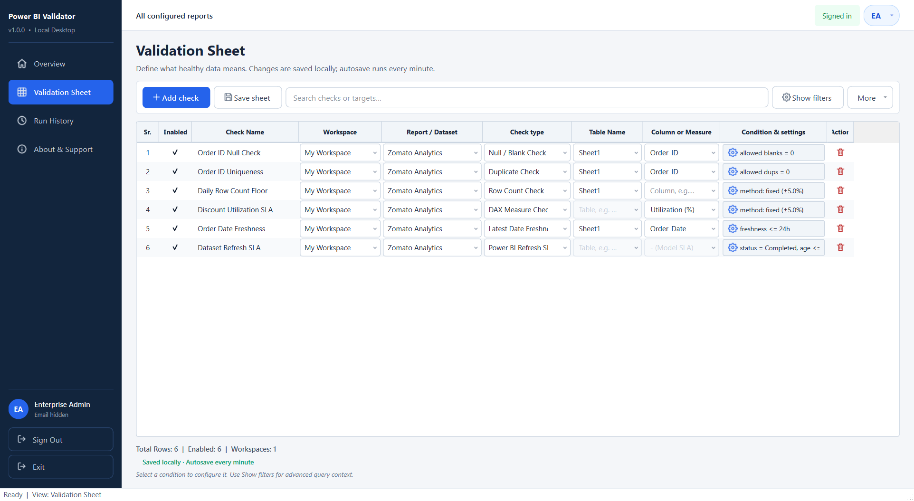
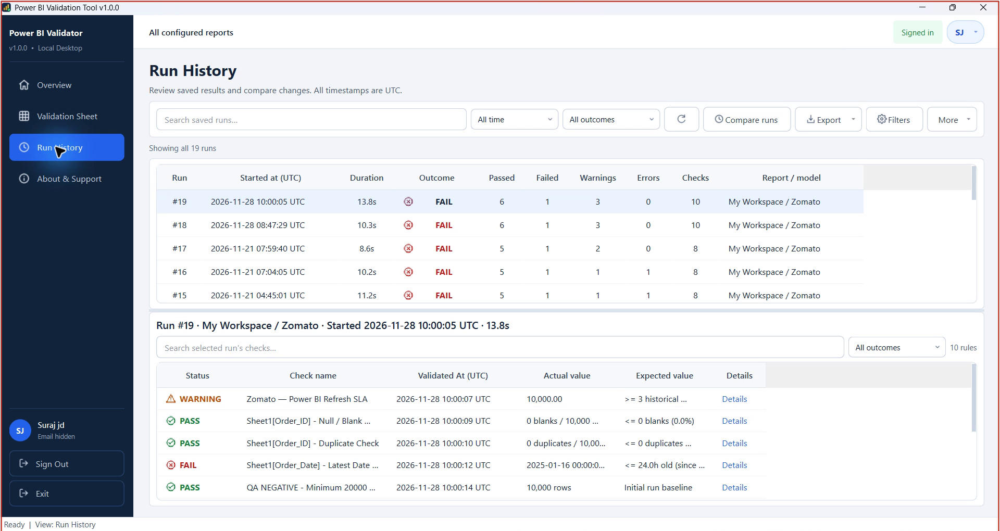
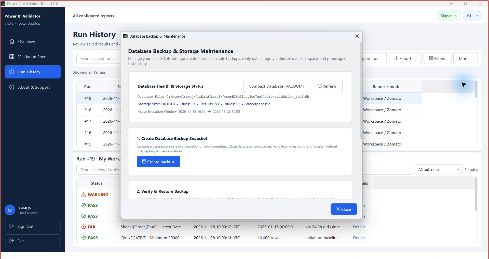
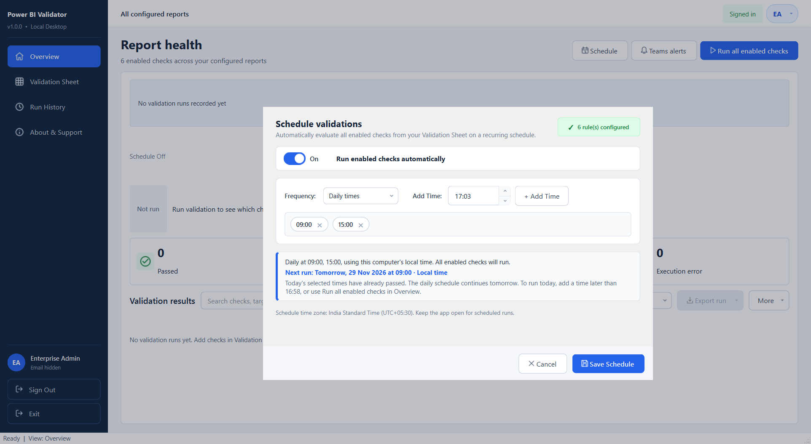
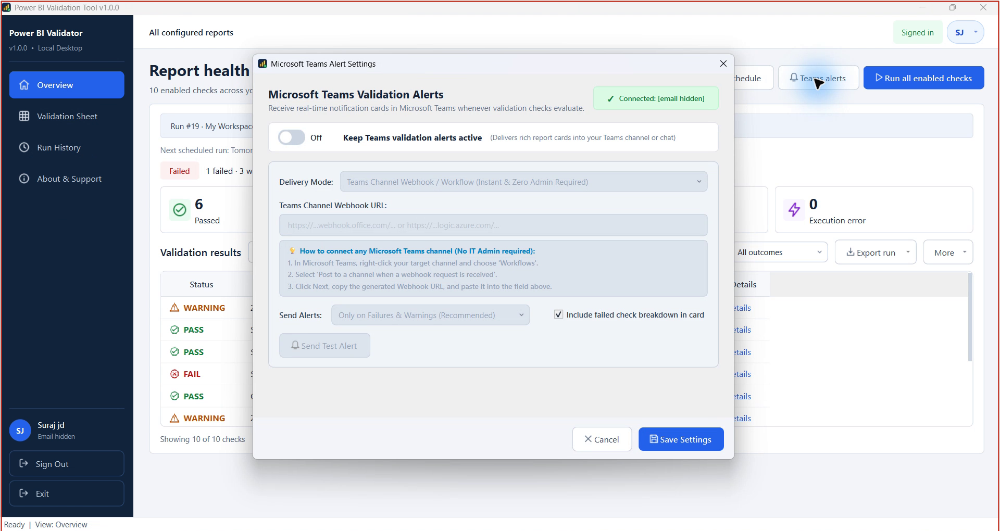
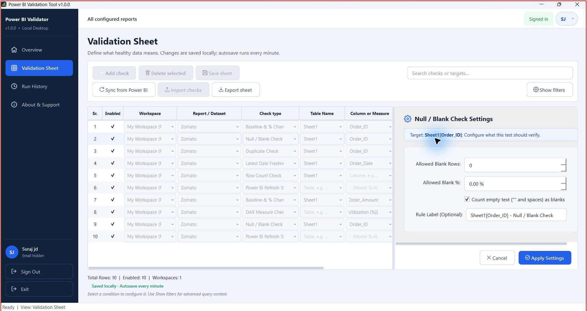
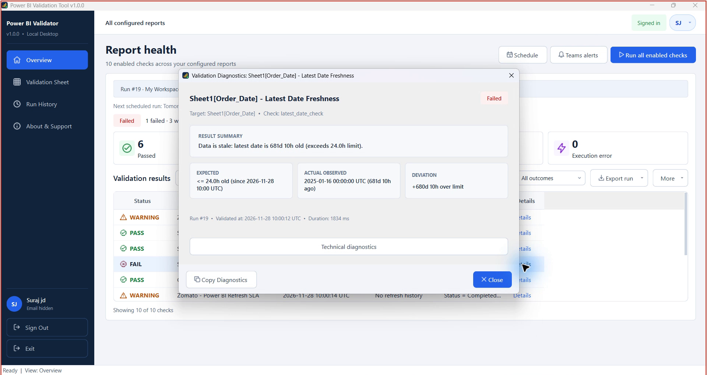

# Power BI Validation Tool

A local-first Windows desktop application for automating Power BI semantic model, refresh, DAX measure, and data quality validation.

[](https://www.python.org/)
[-41CD52.svg)](https://www.qt.io/)
[](https://www.sqlalchemy.org/)
[](docs/RELEASE_NOTES_v1.0.0.md)
[](tests/)

---

## ⚡ The Problem: Why This Tool Is Essential

Managing enterprise Power BI environments often forces BI teams and data engineers to manually inspect dozens or hundreds of reports every single morning:

* **2 to 3 Hours Wasted Daily**: Teams spend hours clicking through workspaces just to verify whether overnight dataset refreshes completed on schedule or failed silently.
* **False-Positive "Successful" Refreshes**: A Power BI dataset refresh might complete successfully with a green checkmark, even when underlying source tables loaded zero rows, missing primary keys, or thousands of duplicate records.
* **Undetected Metric & KPI Drift**: Subtle upstream schema changes or ETL logic shifts can distort critical DAX measures (like gross margin or revenue) without triggering any pipeline error.
* **No Historical Diff or Regression Tracking**: When leadership asks *"Why does this metric differ from yesterday?"*, teams rarely have an audit history to compare validation runs side by side and pinpoint exactly which rule worsened.

### 💡 The Solution: Automated 60-Second Quality Assurance
The **Power BI Validation Tool** automates your entire morning audit routine into a single one-click workflow:
1. **Power BI Refresh SLA Monitoring**: Automatically captures refresh statuses, run durations, and completion ages across all models.
2. **Comprehensive Data Quality Checks**: Enforces row count floors/ceilings, null thresholds, duplicate primary key constraints, and transaction freshness dates.
3. **Live DAX Measure & Baseline Testing**: Directly evaluates complex measures against fixed tolerances or statistical baselines with multi-column filter contexts.
4. **Side-by-Side Run Comparison**: Instantly diff any two validation runs to spot regressions (worsened checks), resolved checks, and schema additions.
5. **Zero-Trust, Local-First Security**: Runs entirely on your local Windows PC using your corporate Microsoft Entra ID. No proprietary data or tokens are ever sent to third-party clouds.

---

## 🎬 Software Tour & Video Walkthrough

[](https://www.youtube.com/watch?v=JnB3j8Ujp7k)

---

## Application screenshots

These full-screen captures show the running Windows application with account email hidden. The saved report includes failed and warning outcomes, which remain visible for review.

### 1. Overview

Run all enabled checks, review the last validation time, and inspect actual versus expected values. Schedule and Teams alerts are beside the run button; optional refresh inspection is under More.


### 2. Validation Sheet

Configure checks in a compact grid, save locally, and reveal advanced filters when needed.



### 3. Run History

A compact toolbar leaves most of the page for saved runs and the selected run's results. Search, filter, compare, and export without leaving the page.



### 4. Run comparison

Compare up to four saved runs and inspect changes in outcomes and actual values.


### 5. Backup and maintenance

Inspect storage statistics, create and verify backups, and access restore or retention tools.



### 6. About and Support

A short quick-start guide, check/result reference, and local support actions replace the development-oriented demonstrations.


### 7. Scheduling

Choose any minute of the day or a custom repeat interval. The preview shows the next date, local time zone, and why a daily run may be scheduled for tomorrow. Keep the app open for scheduled execution.



### 8. Teams alerts

Configure alert delivery and outcomes from the Home toolbar. Account email remains hidden in the dialog.



### 9. Check settings

A side editor keeps the sheet in view on wide windows, with Apply and Cancel always accessible. Smaller windows use a focused dialog.



### 10. Result details

Inspect actual and expected values, the check's validation timestamp, and optional technical diagnostics.



See [the UI update notes](docs/UI_UPDATE_2026-11-28.md) for behavior and verification details.

---

## 🌟 Overview & Key Features

The **Power BI Validation Tool** provides a local-first, zero-trust data quality monitoring engine designed specifically for Power BI semantic models and reports. All query evaluations, statistical calculations, and historical records remain on your local desktop.

### 🛡️ Security & Privacy First
- **No Third-Party Cloud Transmission**: Queries are executed directly against Power BI endpoints via official Microsoft REST APIs; raw data never leaves your local machine.
- **Enterprise Microsoft Entra ID Authentication**: MSAL OAuth 2.0 PKCE sign-in with multi-tenant support (`organizations` or custom tenant ID).
- **Windows DPAPI Encryption**: Tokens are protected with Windows `CryptProtectData` tied directly to your active Windows logon session.
- **Automated Secret Redaction**: Access tokens, bearer auth headers, and client secrets are scrubbed from logs, UI banners, clipboard, and exported files.
- **Azure CLI Fallback**: One-click authentication fallback for developers with active `az login` sessions.

---

## 📋 Comprehensive Capabilities

### 1. Workspace & Dataset Registry (Stages 4, 5 & 6)
- Tabular registry with active/inactive toggles and deletion protection.
- Auto-fill dropdowns populated directly from live Power BI APIs.
- Quick Add dialog for batch workspace/dataset registration.
- Bulk import of datasets via CSV and Excel (`.xlsx`) with row-level validation and error reporting.
- Semantic model metadata discovery (DMVs: `$SYSTEM.TMSCHEMA_TABLES`, `COLUMNS`, `MEASURES` + REST fallback).

### 2. Validation Rule Engine (Stages 7, 10 & 11)
- **Null / Blank Check**: Detects missing or empty strings against count and percentage limits.
- **Duplicate Check**: Validates uniqueness on single or composite primary key columns.
- **Latest Date Freshness Check**: Enforces freshness SLAs (hours/days) and detects future date violations.
- **Row Count Check**: Compares dataset size against fixed baselines, min/max ranges, or previous run row counts.
- **Power BI Refresh SLA Check**: Enforces model refresh SLAs and status (`Completed`, `Failed`, `Unknown`).
- **DAX Measure Check**: Evaluates measures against fixed baselines, percentage deviations, or boundaries.
- **Historical Anomaly Engine**: Statistical anomaly detection using Z-scores ($\sigma$), historical mean/median, lookback windows (7-90 days), weekend filtering, and directional alerts.

### 3. Refresh Monitoring & SLA Tracking (Stage 8)
- Synchronizes and persists Power BI dataset refresh history.
- **In-Progress Protection**: In-progress refreshes return `duration_ms = None` and render `- (In Progress)` (never false completed duration).
- Interactive **Refresh Details Dialog** with live history table, reliability rate, and JSON error diagnostics.

### 4. DAX Query Execution & Inspection (Stage 9)
- Safe identifier escaping (`escape_measure_name`, `escape_table_name`, `escape_column_reference`).
- High-performance result parser explicitly distinguishing `BLANK()` from numeric zero `0`.
- Responsive background `QThread` execution with interactive **DAX Inspector Dialog**.

### 5. Orchestration & Health Dashboard (Stages 12 & 13)
- Sequential rule execution with cooperative cancellation and mutex protection against concurrent runs.
- Centerpiece health dashboard with "▶ Run Validation" and "Cancel" buttons.
- Five summary KPI cards: Overall Health, Passed, Failed, Warnings, Errors.
- Live search filter and status filter ("Failed Only", "Warnings Only", etc.).
- Interactive results table with **Result Details Dialog** for deep diagnostic inspection.

### 6. Audit History, Diff Comparison & Exports (Stage 14)
- Complete execution history log with chronological sorting and status filters.
- Side-by-side **Run Comparison Dialog** identifying regressions and improvements.
- One-click export to CSV and styled Excel (`.xlsx`) workbooks.
- Sanitized diagnostic log export with secrets redacted.
- Database backup, integrity validation (`PRAGMA integrity_check`), restore, and historical retention pruning.

### 7. Packaging & Distribution (Stage 15)
- Standalone Windows executable configuration ([powerbi_validation_tool.spec](powerbi_validation_tool.spec)).
- Inno Setup installer script ([installer/PowerBI_Validation_Tool.iss](installer/PowerBI_Validation_Tool.iss)).

---

## 🚀 Setup & Run (Windows PowerShell)

### Prerequisites
- Windows 10 or 11 (64-bit)
- Python 3.12+ (or use the standalone packaged executable)

### Quick Start

```powershell
# 1. Clone repository and navigate to folder
cd d:\Games\Antigravity\Data_Validation

# 2. Create virtual environment
py -3.12 -m venv C:\Users\suraj\.venvs\powerbi-validation-tool

# 3. Activate virtual environment
C:\Users\suraj\.venvs\powerbi-validation-tool\Scripts\Activate.ps1

# 4. Install dependencies
pip install -r requirements.txt

# 5. Launch the application (CLI)
python -m app.main
```

### 🚀 Double-Click Launch (No Terminal Required)
You can launch the application directly without opening a terminal:
* **Desktop Shortcut**: Double-click the **Power BI Validator** icon on your Desktop.
* **Silent Launcher**: Double-click `Launch App.vbs` in the project root to start the app with zero console flicker.
* **Batch Launcher**: Double-click `Launch App.bat` in the project root.
* **Recreate Shortcut**: Run `create_desktop_shortcut.bat` at any time to generate a fresh Desktop shortcut.

---

## 🧪 Automated Testing

Run the complete automated test suite (255 unit and UI tests):

```powershell
# Run all tests
pytest

# Run tests with verbose output
pytest -v

# Run specific test modules
pytest tests/unit/test_basic_validators.py
pytest tests/unit/test_anomaly_engine.py
pytest tests/unit/test_orchestrator.py
pytest tests/ui/test_dashboard_ui.py
pytest tests/ui/test_history_ui.py
```

---

## 📦 Building Standalone Executable

To compile a self-contained Windows desktop distribution using PyInstaller:

```powershell
# Build executable using the specification file
pyinstaller --noconfirm powerbi_validation_tool.spec
```

The output will be placed in `dist/PowerBIValidationTool/`.

---

## 📂 Architecture & Directory Structure

```text
Data_Validation/
├── app/
│   ├── auth/                  # MSAL & Azure CLI authentication, DPAPI token cache
│   ├── core/                  # App configuration, logging redaction, exceptions, statuses
│   ├── database/              # SQLite connection, Alembic migrations, SQLAlchemy models, repositories
│   ├── integrations/          # Power BI REST client, workspace/dataset/metadata/refresh/DAX clients
│   ├── services/              # Orchestrator, rule, refresh, comparison, export, backup, registry services
│   ├── ui/                    # PySide6 desktop interface (pages, dialogs, widgets, enterprise theme)
│   ├── validation/            # Validation engine, base validator, models, statistics, and validators
│   └── main.py                # Application entry point
├── assets/                    # Application icons and SVG vectors
├── docs/                      # Release notes and design specifications
├── installer/                 # Inno Setup Windows installer script
├── tests/
│   ├── ui/                    # Qt UI automated tests with pytest-qt
│   └── unit/                  # Unit tests for clients, services, validators, and database
├── powerbi_validation_tool.spec # PyInstaller build specification
├── pyproject.toml             # Project metadata and configuration
├── requirements.txt           # Production and development dependencies
└── README.md                  # This file
```

---

## 📄 License & Notes

Designed and maintained for enterprise Power BI semantic model governance and automated data quality assurance.
For full release details, see [docs/RELEASE_NOTES_v1.0.0.md](docs/RELEASE_NOTES_v1.0.0.md).
